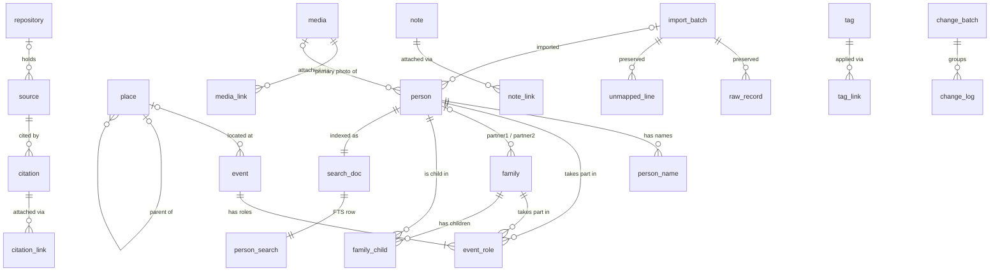

# open-ancestry data model

Current schema version: **1**

This is the reference for the local data format: the SQLite schema inside every tree, the rules the code keeps on top of it, and the JSON interchange format. It is owned by `packages/db`. `packages/db/src/data-model-doc.test.ts` fails if a table or column exists in the live database but not here (or the other way round), or if an enum value is missing, so this document cannot drift from the DDL.

- DDL: `packages/db/src/migrations/v001-initial.ts` (frozen dump: `packages/db/src/migrations/history/schema-v1.sql`)
- Row types: `packages/db/src/types.ts`; enums: `packages/db/src/enums.ts`
- JSON Schema for interchange: `packages/db/schema/oa-json.schema.json`

## Contents

1. [Storage layout](#storage-layout)
2. [Conventions](#conventions)
3. [Entity relationship diagram](#entity-relationship-diagram)
4. [Tables](#tables)
5. [Living status and privacy](#living-status-and-privacy)
6. [Dates](#dates)
7. [How GEDCOM and Ancestry map](#how-gedcom-and-ancestry-map)
8. [Change log, undo and redo](#change-log-undo-and-redo)
9. [Search index](#search-index)
10. [JSON interchange](#json-interchange)
11. [Versioning policy](#versioning-policy)

## Storage layout

A tree is a folder that can be copied, backed up or synced as a unit:

```
~/OpenAncestry/
  Vale Family.oatree/
    tree.sqlite        SQLite database (WAL mode; -wal and -shm files appear while open)
    media/             original media files, referenced by media.local_path
    thumbs/            generated thumbnails (derived, safe to delete)
```

Connections use `journal_mode=WAL`, `synchronous=NORMAL`, `foreign_keys=ON`, `temp_store=MEMORY`, a 256 MB `mmap_size`, a 64 MB page cache and a 5 s busy timeout.

## Conventions

- **Ids** are [ULIDs](https://github.com/ulid/spec): 26-character, time-sortable text. GEDCOM xrefs (`@I12@`) are never keys; they are kept in `external_id` together with the `import_batch_id` that read them, because Ancestry may renumber xrefs between exports.
- **STRICT tables**: SQLite enforces column types, so values round-trip exactly.
- **Booleans** are `INTEGER` 0 or 1.
- **Timestamps** are ISO-8601 UTC text (`2026-10-14T09:30:00.000Z`). `created_at` is set on insert; `updated_at` on every change made through the unit of work.
- **Foreign keys** are `DEFERRABLE INITIALLY DEFERRED` (checked at commit, so loaders and undo can write in any order) and have **no** `ON DELETE` actions. Cascades are explicit writes made by the repositories, so every one of them lands in the change log and can be undone.
- **Polymorphic links** (`citation_link`, `media_link`, `note_link`, `tag_link`, `raw_record`, `unmapped_line`) point at an owner with `owner_type` (a table name) and `owner_id`. SQLite cannot enforce these references; the repositories delete them together with their owner.
- **Ordering** columns (`sort_order`, `partner1_order`, `partner2_order`) are small integers, ascending; ties break by `id`.

## Entity relationship diagram



Polymorphic links (`*_link.owner_id`, `raw_record.owner_id`, `unmapped_line.owner_id`) are not drawn; see each table.

## Tables

### `meta`

Key/value settings for the tree.

| Column | Type | Null | Meaning |
|---|---|---|---|
| `key` | TEXT | no | Primary key. Known keys: `schema_version` (written only by migrations; `meta.set` and `meta.delete` refuse it), `tree_name`, `created_at`, `home_person_id` (the person relationships are described from), `settings` (JSON object of UI preferences). |
| `value` | TEXT | no | Value as text. |

### `import_batch`

One row per import run (GEDCOM, GEDZIP or JSON).

| Column | Type | Null | Meaning |
|---|---|---|---|
| `id` | TEXT | no | ULID. |
| `file_name` | TEXT | yes | Original file name, without directories. |
| `file_sha256` | TEXT | yes | Hex SHA-256 of the imported file. |
| `format` | TEXT | yes | `gedcom-5.5.1`, `gedcom-7`, `gedzip` or `json`. |
| `source_software` | TEXT | yes | `HEAD.SOUR` of the file, e.g. `Ancestry.com Family Trees`. |
| `source_version` | TEXT | yes | `HEAD.SOUR.VERS`. |
| `status` | TEXT | no | `running`, `completed` or `failed`. Default `running`. |
| `counts_json` | TEXT | no | JSON object of record counts per type, for the import report. |
| `warnings_json` | TEXT | no | JSON array of warnings (`{ line, message }`). |
| `started_at` | TEXT | no | When the import began. |
| `finished_at` | TEXT | yes | When it completed or failed. |

### `person`

An individual (GEDCOM `INDI`).

| Column | Type | Null | Meaning |
|---|---|---|---|
| `id` | TEXT | no | ULID. |
| `sex` | TEXT | no | `M`, `F`, `X` (intersex/other) or `U` (unknown, default). |
| `living` | TEXT | no | `living`, `dead`, `inferred_living`, `inferred_dead` or `unknown` (default). See [living status](#living-status-and-privacy). |
| `privacy` | TEXT | no | `public` (default), `private`, `confidential` or `locked`. GEDCOM `RESN`: `privacy` maps to `private`. |
| `primary_media_id` | TEXT | yes | FK `media.id`: the profile photo (Ancestry `_PHOTO`, or an `OBJE` with `_PRIM Y`). |
| `external_id` | TEXT | yes | GEDCOM xref (`@I12@`) in the import that created the row. |
| `import_batch_id` | TEXT | yes | FK `import_batch.id`; null for people created in the app. |
| `created_at` | TEXT | no | Insert time. |
| `updated_at` | TEXT | no | Last change. |

### `person_name`

Every name a person is known by (GEDCOM `NAME`, one row per occurrence).

| Column | Type | Null | Meaning |
|---|---|---|---|
| `id` | TEXT | no | ULID. |
| `person_id` | TEXT | no | FK `person.id`. |
| `type` | TEXT | no | `birth` (default), `married`, `maiden`, `aka`, `immigrant`, `professional`, `religious` or `other` (GEDCOM `NAME.TYPE`). |
| `given` | TEXT | yes | Given names (`GIVN`, or the part before the slashes). |
| `surname` | TEXT | yes | Surname without prefix (`SURN`, or the part between slashes). |
| `surname_prefix` | TEXT | yes | `SPFX`, e.g. `van`, `de`. |
| `prefix` | TEXT | yes | `NPFX`, e.g. `Rev.`. |
| `suffix` | TEXT | yes | `NSFX`, e.g. `Jr.`. |
| `nickname` | TEXT | yes | `NICK`. |
| `full_text` | TEXT | yes | The name exactly as written in the source, e.g. `Ellis /Vale/ Jr.`. |
| `surname_key` | TEXT | yes | Phonetic key of the surname, computed by the caller (packages/core, e.g. Double Metaphone) and used by search. |
| `is_primary` | INTEGER | no | 1 for the display name. Invariant: a person with names has exactly one primary (unique partial index `person_name_primary_uq`). |
| `sort_order` | INTEGER | no | Order among the person's names. |

### `place`

A place hierarchy. Imports create one row per distinct `PLAC` string; `parent_id` is filled when the hierarchy is known.

| Column | Type | Null | Meaning |
|---|---|---|---|
| `id` | TEXT | no | ULID. |
| `name` | TEXT | no | This level only, e.g. `Brackenford`. |
| `full_name` | TEXT | no | Full jurisdiction string as displayed and searched, e.g. `Brackenford, Wexmoor, Westmere`. |
| `parent_id` | TEXT | yes | FK `place.id` of the enclosing place. |
| `type` | TEXT | yes | Free text: `city`, `county`, `country`, ... |
| `latitude` | REAL | yes | Decimal degrees, -90..90 (`MAP.LATI`). |
| `longitude` | REAL | yes | Decimal degrees, -180..180 (`MAP.LONG`). |
| `created_at` | TEXT | no | Insert time. |
| `updated_at` | TEXT | no | Last change. |

### `event`

A dated fact or event (GEDCOM `BIRT`, `DEAT`, `MARR`, `RESI`, `OCCU`, `EVEN`, `_MILT`, ...). Who it belongs to is in `event_role`, so one event (a census, a marriage) can be shared.

| Column | Type | Null | Meaning |
|---|---|---|---|
| `id` | TEXT | no | ULID. |
| `type` | TEXT | no | GEDCOM tag, including custom ones (`BIRT`, `_MILT`, `EVEN`, `FACT`). |
| `custom_type` | TEXT | yes | `EVEN.TYPE` / `FACT.TYPE` text, e.g. `Arrival`. |
| `date_text` | TEXT | yes | Date exactly as written, never rewritten (`Abt. 1842`, `05/28/1960`). |
| `date_qualifier` | TEXT | yes | Qualifier from the date parser in packages/core (`exact`, `about`, `before`, `between`, ... or `text` when unparseable). Not CHECK-constrained so the parser can evolve. |
| `date_sort` | INTEGER | yes | Sort key `YYYYMMDD` from the date parser; missing parts at their midpoint. Null when undated or unparseable. |
| `date_sort_end` | INTEGER | yes | Sort key of the range end for `BET .. AND` / `FROM .. TO`. |
| `calendar` | TEXT | yes | `gregorian`, `julian`, `hebrew`, `french_r`; null means gregorian. |
| `place_id` | TEXT | yes | FK `place.id`. |
| `value` | TEXT | yes | The tag's line value, e.g. the occupation for `OCCU`, `Y` for `MARR Y`. |
| `description` | TEXT | yes | Free-text description. |
| `age` | TEXT | yes | `AGE` as written (age of the principal at the event). |
| `cause` | TEXT | yes | `CAUS`, e.g. cause of death. |
| `privacy` | TEXT | no | `public` (default), `private`, `confidential` or `locked`. |
| `import_batch_id` | TEXT | yes | FK `import_batch.id`. |
| `created_at` | TEXT | no | Insert time. |
| `updated_at` | TEXT | no | Last change. |

### `event_role`

Links an event to a person or a family, with their role.

| Column | Type | Null | Meaning |
|---|---|---|---|
| `id` | TEXT | no | ULID. |
| `event_id` | TEXT | no | FK `event.id`. |
| `person_id` | TEXT | yes | FK `person.id`. Exactly one of `person_id` / `family_id` is set (CHECK). |
| `family_id` | TEXT | yes | FK `family.id`, for family events such as `MARR`, `DIV`. |
| `role` | TEXT | no | `principal` (default; the person the fact is about), or a GEDCOM 7 `ROLE`: `witness`, `godparent`, `officiator`, `clergy`, `informant`, `parent`, `father`, `mother`, `child`, `spouse`, `husband`, `wife`, `friend`, `neighbor`, `multiple`, `other`. |
| `is_preferred` | INTEGER | no | 1 (default) for the preferred fact among alternates of the same type (two `BIRT` records with different dates). |
| `sort_order` | INTEGER | no | Order among the owner's events with equal dates. |

### `family`

A couple, or a single parent, with their children (GEDCOM `FAM`).

| Column | Type | Null | Meaning |
|---|---|---|---|
| `id` | TEXT | no | ULID. |
| `partner1_id` | TEXT | yes | FK `person.id` (GEDCOM `HUSB`). |
| `partner2_id` | TEXT | yes | FK `person.id` (GEDCOM `WIFE`). Partners are never the same person (CHECK). |
| `relationship_type` | TEXT | no | `married`, `civil_union`, `partners` or `unknown` (default). |
| `partner1_order` | INTEGER | no | Position of this family among partner1's families (order of `FAMS`). |
| `partner2_order` | INTEGER | no | Position among partner2's families. |
| `privacy` | TEXT | no | `public` (default), `private`, `confidential` or `locked`. |
| `external_id` | TEXT | yes | GEDCOM xref (`@F3@`). |
| `import_batch_id` | TEXT | yes | FK `import_batch.id`. |
| `created_at` | TEXT | no | Insert time. |
| `updated_at` | TEXT | no | Last change. |

### `family_child`

A child in a family, with the child's relationship to each partner. A person can be a child in several families (birth parents and adoptive parents).

| Column | Type | Null | Meaning |
|---|---|---|---|
| `id` | TEXT | no | ULID. |
| `family_id` | TEXT | no | FK `family.id`. Unique with `child_id`. |
| `child_id` | TEXT | no | FK `person.id`. |
| `partner1_rel` | TEXT | no | Relationship to partner1: `biological` (default), `adopted`, `step`, `foster`, `related`, `guardian`, `private` or `unknown`. |
| `partner2_rel` | TEXT | no | Relationship to partner2, same values. |
| `sort_order` | INTEGER | no | Birth order within the family. |
| `child_order` | INTEGER | no | Position of this family among the child's parent families (order of `INDI.FAMC`), e.g. birth parents before adoptive parents. |
| `is_preferred` | INTEGER | no | 1 for the child's preferred parent family, the parent set tree views draw by default. Invariant: a person who is a child in any family has exactly one preferred link (unique partial index `family_child_preferred_uq`); the first link added is preferred, and removing it promotes the next by `child_order`. |

### `repository`

Where sources are held (GEDCOM `REPO`).

| Column | Type | Null | Meaning |
|---|---|---|---|
| `id` | TEXT | no | ULID. |
| `name` | TEXT | no | Name. |
| `address` | TEXT | yes | Postal address as one text block. |
| `url` | TEXT | yes | `WWW`. |
| `email` | TEXT | yes | `EMAIL`. |
| `phone` | TEXT | yes | `PHON`. |
| `external_id` | TEXT | yes | GEDCOM xref. |
| `import_batch_id` | TEXT | yes | FK `import_batch.id`. |
| `created_at` | TEXT | no | Insert time. |
| `updated_at` | TEXT | no | Last change. |

### `source`

A source record (GEDCOM `SOUR` record): a book, register, database.

| Column | Type | Null | Meaning |
|---|---|---|---|
| `id` | TEXT | no | ULID. |
| `title` | TEXT | no | `TITL`. |
| `author` | TEXT | yes | `AUTH`. |
| `publication` | TEXT | yes | `PUBL`. |
| `abbreviation` | TEXT | yes | `ABBR`. |
| `text` | TEXT | yes | `TEXT`. |
| `repository_id` | TEXT | yes | FK `repository.id` (`REPO` pointer). |
| `call_number` | TEXT | yes | `REPO.CALN`. |
| `apid` | TEXT | yes | Ancestry `_APID` on the source record (`1,7602::0`): identifies the Ancestry database. |
| `external_id` | TEXT | yes | GEDCOM xref (`@S4@`). |
| `import_batch_id` | TEXT | yes | FK `import_batch.id`. |
| `created_at` | TEXT | no | Insert time. |
| `updated_at` | TEXT | no | Last change. |

### `citation`

A specific use of a source (a GEDCOM `SOUR` pointer with its `PAGE`, `QUAY`, `DATA`).

| Column | Type | Null | Meaning |
|---|---|---|---|
| `id` | TEXT | no | ULID. |
| `source_id` | TEXT | no | FK `source.id`. |
| `page` | TEXT | yes | `PAGE`: where in the source. |
| `quality` | INTEGER | yes | `QUAY` 0..3. |
| `date_text` | TEXT | yes | `DATA.DATE` as written. |
| `text` | TEXT | yes | `DATA.TEXT`. |
| `apid` | TEXT | yes | Ancestry `_APID` (`1,7602::123456`): database and record id, rendered as a link to the Ancestry record. |
| `url` | TEXT | yes | `WWW`. |
| `created_at` | TEXT | no | Insert time. |
| `updated_at` | TEXT | no | Last change. |

### `citation_link`

Attaches a citation to what it supports.

| Column | Type | Null | Meaning |
|---|---|---|---|
| `id` | TEXT | no | ULID. |
| `citation_id` | TEXT | no | FK `citation.id`. |
| `owner_type` | TEXT | no | `person`, `person_name`, `event`, `family`, `family_child`, `media` or `note`. |
| `owner_id` | TEXT | no | Id in the owner table. Unique with `citation_id` and `owner_type`. |
| `sort_order` | INTEGER | no | Order on the owner. |

### `media`

A photo, document scan, audio or video, stored locally or known only by remote URL.

| Column | Type | Null | Meaning |
|---|---|---|---|
| `id` | TEXT | no | ULID. |
| `kind` | TEXT | no | `photo` (default), `document`, `audio`, `video` or `other`. |
| `mime` | TEXT | yes | MIME type, e.g. `image/jpeg`. |
| `local_path` | TEXT | yes | Path relative to the tree's `media/` folder, forward slashes. CHECK rejects absolute paths, drive letters, backslashes and `..` segments (servers still verify the resolved path). |
| `remote_url` | TEXT | yes | Original URL (Ancestry media URL). Never fetched automatically. |
| `ancestry_oid` | TEXT | yes | Ancestry `_OID`, the media id used to show placeholders and match later downloads. |
| `title` | TEXT | yes | `TITL`. |
| `date_text` | TEXT | yes | Date as written. |
| `description` | TEXT | yes | Caption or description. |
| `sha256` | TEXT | yes | Hex SHA-256 of the local file, for deduplication. |
| `width` | INTEGER | yes | Pixels. |
| `height` | INTEGER | yes | Pixels. |
| `byte_size` | INTEGER | yes | File size. |
| `external_id` | TEXT | yes | GEDCOM xref (`@O1@`). |
| `import_batch_id` | TEXT | yes | FK `import_batch.id`. |
| `created_at` | TEXT | no | Insert time. |
| `updated_at` | TEXT | no | Last change. |

### `media_link`

Attaches media to an owner.

| Column | Type | Null | Meaning |
|---|---|---|---|
| `id` | TEXT | no | ULID. |
| `media_id` | TEXT | no | FK `media.id`. |
| `owner_type` | TEXT | no | `person`, `event`, `family`, `source`, `citation` or `place`. |
| `owner_id` | TEXT | no | Id in the owner table. Unique with `media_id` and `owner_type`. |
| `sort_order` | INTEGER | no | Order in the owner's gallery. |
| `crop_json` | TEXT | yes | JSON `{x, y, w, h}` (fractions of the image) for a face crop. |

### `note`

A note (GEDCOM `NOTE` record or inline note; `CONC`/`CONT` already joined).

| Column | Type | Null | Meaning |
|---|---|---|---|
| `id` | TEXT | no | ULID. |
| `text` | TEXT | no | Note text with real newlines. |
| `external_id` | TEXT | yes | GEDCOM xref for shared notes; null for inline notes. |
| `import_batch_id` | TEXT | yes | FK `import_batch.id`. |
| `created_at` | TEXT | no | Insert time. |
| `updated_at` | TEXT | no | Last change. |

### `note_link`

Attaches a note to an owner.

| Column | Type | Null | Meaning |
|---|---|---|---|
| `id` | TEXT | no | ULID. |
| `note_id` | TEXT | no | FK `note.id`. |
| `owner_type` | TEXT | no | `person`, `person_name`, `event`, `family`, `family_child`, `source`, `citation`, `media`, `place` or `repository`. |
| `owner_id` | TEXT | no | Id in the owner table. Unique with `note_id` and `owner_type`. |
| `sort_order` | INTEGER | no | Order on the owner. |

### `tag`

A label, such as Ancestry MyTreeTags (`_MTTAG` with `_MTCAT` category).

| Column | Type | Null | Meaning |
|---|---|---|---|
| `id` | TEXT | no | ULID. |
| `name` | TEXT | no | Tag name, unique within its category. |
| `category` | TEXT | no | Category (`_MTCAT`), `''` when none. |
| `color` | TEXT | yes | CSS color for the badge. |
| `external_id` | TEXT | yes | GEDCOM xref of the `_MTTAG` record. |
| `import_batch_id` | TEXT | yes | FK `import_batch.id`. |
| `created_at` | TEXT | no | Insert time. |
| `updated_at` | TEXT | no | Last change. |

### `tag_link`

Applies a tag.

| Column | Type | Null | Meaning |
|---|---|---|---|
| `id` | TEXT | no | ULID. |
| `tag_id` | TEXT | no | FK `tag.id`. |
| `owner_type` | TEXT | no | `person`, `family`, `event`, `media` or `source`. |
| `owner_id` | TEXT | no | Id in the owner table. Unique with `tag_id` and `owner_type`. |

### `raw_record`

The verbatim GEDCOM text of every top-level record, for lossless export (custom tags survive even if they were never mapped).

| Column | Type | Null | Meaning |
|---|---|---|---|
| `id` | TEXT | no | ULID. |
| `import_batch_id` | TEXT | no | FK `import_batch.id`. |
| `seq` | INTEGER | no | Position of the record in the file (0 = `HEAD`), to export in the original order. |
| `owner_type` | TEXT | yes | Table the record mapped to (`person`, `family`, `source`, ...); null for `HEAD`, `SUBM`, `TRLR`. |
| `owner_id` | TEXT | yes | Id of that row. |
| `gedcom_tag` | TEXT | no | Record tag (`INDI`, `FAM`, `_MTTAG`). |
| `xref` | TEXT | yes | Record xref. |
| `raw_text` | TEXT | no | The record's lines exactly as read (after decoding to UTF-8), newline separated. |

### `unmapped_line`

Lines the mapper did not understand. With `raw_record` this guarantees every input line is accounted for.

| Column | Type | Null | Meaning |
|---|---|---|---|
| `id` | TEXT | no | ULID. |
| `import_batch_id` | TEXT | no | FK `import_batch.id`. |
| `owner_type` | TEXT | yes | Table of the row the line was under, if any. |
| `owner_id` | TEXT | yes | Id of that row. |
| `path` | TEXT | no | Tag path, e.g. `INDI.BIRT._XYZ`. |
| `line_no` | INTEGER | no | 1-based line number in the file. |
| `line` | TEXT | no | The line as read. |

### `change_batch`

One unit of work (one user action). See [undo and redo](#change-log-undo-and-redo).

| Column | Type | Null | Meaning |
|---|---|---|---|
| `id` | TEXT | no | ULID; sorts in creation order. |
| `label` | TEXT | no | Human label for the history panel, e.g. `Edit birth of Ellis Vale`. |
| `state` | TEXT | no | `applied` (default), `undone`, or `superseded` (was undone, then a new edit discarded the redo stack). |
| `created_at` | TEXT | no | When the batch was committed. |
| `state_changed_at` | TEXT | yes | Last undo, redo or supersede. |

### `change_log`

Every row-level change made through the unit of work, with full before and after images.

| Column | Type | Null | Meaning |
|---|---|---|---|
| `seq` | INTEGER | no | Autoincrement sequence; replay order. |
| `batch_id` | TEXT | no | FK `change_batch.id`. |
| `ts` | TEXT | no | Batch timestamp. |
| `entity` | TEXT | no | Table name. |
| `entity_id` | TEXT | no | Primary key of the row (`meta` uses its `key`). |
| `op` | TEXT | no | `insert`, `update` or `delete`. |
| `before_json` | TEXT | yes | Whole row before (JSON, columns in table order); null for inserts. |
| `after_json` | TEXT | yes | Whole row after; null for deletes. CHECK ties nullness to `op`. |

### `search_doc`

Derived: maps each person to their full-text row. Not exported; rebuilt on import.

| Column | Type | Null | Meaning |
|---|---|---|---|
| `doc_id` | INTEGER | no | Rowid of the person's `person_search` row. |
| `person_id` | TEXT | no | `person.id` (unique). |

### `person_search`

Derived FTS5 table (`unicode61 remove_diacritics 2`, prefix indexes for 2 and 3 characters), one row per person. Not exported.

| Column | Type | Null | Meaning |
|---|---|---|---|
| `names` | FTS | yes | All name variants: prefix, given, nickname, surname prefix, surname, suffix. |
| `phonetic` | FTS | yes | All `person_name.surname_key` values. |
| `places` | FTS | yes | `full_name` of places of events where the person is principal. |
| `years` | FTS | yes | Years (`date_sort / 10000`) of those events. |

## Living status and privacy

`person.living` separates what the user said from what the app inferred:

| Value | Set by | Meaning |
|---|---|---|
| `living` | user | Explicitly living. Never overwritten by inference. |
| `dead` | user | Explicitly deceased. Never overwritten by inference. |
| `inferred_living` | inference | No death facts, and born under 100 years ago (or birth unknown with living descendants). |
| `inferred_dead` | inference | A death, burial or cremation fact exists, or born 100 or more years ago. |
| `unknown` | default | Inference has not run. |

Inference (packages/core, run by the importer and after edits) only ever writes the `inferred_*` values, and only on rows that are not `living`/`dead`. For privacy features (the "privatize living" export, sharing) `isLiving()` treats `living`, `inferred_living` and `unknown` as living, so a missing answer errs on the side of privacy.

`privacy` on person, event and family records the GEDCOM `RESN` restriction (`confidential`, `locked`, `privacy` mapped to `private`) or a user choice; `public` is the default.

## Dates

Dates are parsed by packages/core and stored as five columns on `event` (and `date_text` alone on `citation` and `media`):

- `date_text` keeps the original string, always.
- `date_qualifier`, `date_sort`, `date_sort_end`, `calendar` come from the parser. `date_sort` is an integer `YYYYMMDD` (missing month or day set to the midpoint, offsets for qualifiers) indexed by `event_date_sort_idx`, so timelines and "born between" queries sort and filter numerically.
- Unparseable input is kept with `date_qualifier = 'text'` and null sort keys.

packages/db does not parse dates; callers pass these fields in.

## How GEDCOM and Ancestry map

| GEDCOM / Ancestry | Stored as |
|---|---|
| `INDI` | `person`; xref in `external_id` |
| `INDI.NAME` (each) | `person_name`; first is primary; `TYPE` to `type` |
| `INDI.SEX` | `person.sex` |
| `INDI.BIRT`, `DEAT`, `RESI`, `OCCU`, `_MILT`, `EVEN`/`TYPE`, ... | `event` + `event_role` (`principal`) |
| `INDI.MARR` duplicating a `FAM.MARR` | deduplicated into the family event |
| `FAM` | `family`; `HUSB` to `partner1_id`, `WIFE` to `partner2_id` |
| Order of `INDI.FAMC`; the first (or Ancestry's preferred) parent set | `family_child.child_order`; `family_child.is_preferred` |
| `FAM.CHIL` + `INDI.FAMC.PEDI`, Ancestry `_FREL`/`_MREL` | `family_child.partner1_rel` / `partner2_rel` (`Natural` to `biological`, `Adopted`, `Step`, `Foster`, `Related`, `Guardian`, `Private`) |
| `FAM.MARR`, `DIV`, ... | `event` + `event_role` with `family_id` |
| `PLAC` (and `MAP`) | `place` (deduplicated by `full_name`) |
| `SOUR` record | `source`; Ancestry `_APID` to `source.apid` |
| `SOUR` pointer with `PAGE`, `QUAY`, `DATA` | `citation` + `citation_link`; Ancestry `_APID` to `citation.apid` |
| `REPO` | `repository` |
| `OBJE` record / link | `media` + `media_link`; Ancestry `_OID` to `ancestry_oid`; `FILE` URL to `remote_url`, local file to `local_path` |
| Ancestry `_PHOTO`, `OBJE._PRIM Y` | `person.primary_media_id` |
| `NOTE` (record or inline) | `note` + `note_link` |
| Ancestry `_MTTAG` record (`NAME`, `_MTCAT`) and pointers | `tag` + `tag_link` |
| `RESN` | `privacy` |
| `HEAD`, `SUBM`, `TRLR` | `raw_record` only, with null `owner_type`/`owner_id` (no submitter table in v1; `HEAD.SOUR` details also go to `import_batch`) |
| Every top-level record verbatim | `raw_record` |
| Anything not mapped | `unmapped_line` |
| `HEAD.SOUR`, file metadata | `import_batch` |

## Change log, undo and redo

All edits go through `store.transact(label, tx => ...)`. One call is one `change_batch` and one SQLite transaction; each insert, update and delete appends a `change_log` row with full before and after images, including the cascades repositories perform (deleting a person deletes their names, roles, orphaned events, child links and owned links, and detaches them from families). A transaction that changes nothing leaves no batch.

- **Undo** replays a batch's log newest-first, restoring each row's `before_json`; **redo** replays oldest-first, restoring `after_json`. Both run in one transaction and keep the search index in sync.
- **Conflict check:** before restoring a row, its current value must equal the image being replaced. If a later batch changed the same row, the operation fails with `UndoConflictError` and nothing changes.
- **Redo stack:** committing a new batch marks every `undone` batch `superseded`; superseded batches cannot be redone. `undoLast` takes the newest `applied` batch, `redoLast` the oldest `undone` one.
- **Bulk import** (`BulkWriter`) does not write `change_log` rows: a v1 import creates a new tree, and undoing it means deleting the tree.

Property tests (fast-check) apply random edit scripts and assert that undoing every batch restores each earlier snapshot byte for byte, and redoing restores each later one.

## Search index

`person_search` is maintained by the unit of work: writes to `person`, `person_name`, `event_role`, `event` and `place` mark the affected people, whose documents are rewritten at commit. Bulk loads rebuild the whole index once at the end. `searchPeople` requires every query word to prefix-match a name, place or year (FTS5 syntax in the query is ignored), optionally ORs in caller-supplied phonetic keys, and ranks by BM25 with names weighted 10, phonetic keys 5, places and years 1.

## JSON interchange

`exportJson` / `importJson` read and write `open-ancestry.json`: a full-fidelity dump of every table except the derived search tables.

```json
{
  "format": "open-ancestry",
  "formatVersion": 1,
  "schemaVersion": 1,
  "tables": {
    "change_batch": [],
    "person": [{ "id": "01J...", "sex": "F", "living": "inferred_dead", "...": "..." }]
  }
}
```

- Rows have exactly the table's columns, in schema order. Tables appear in name order; rows are sorted by primary key. The file is `JSON.stringify(doc, null, 2)` plus a trailing newline. This canonical form makes export, import into a new tree, and export again byte-identical (tested).
- `change_batch` and `change_log` are included by default (so undo history survives a round-trip) and can be left out with `{ history: false }`.
- Import requires an empty tree with the same `schemaVersion`; it loads everything in one transaction and rebuilds the search index.
- The JSON Schema in `packages/db/schema/oa-json.schema.json` is generated from the live schema (`npm run generate:json-schema -w @open-ancestry/db`); a test fails if it is stale, and exports are validated against it.

## Versioning policy

- `meta.schema_version` holds the applied migration number. Migrations are forward-only: a database is never downgraded, and opening a database newer than the app is refused.
- Each migration runs in its own transaction; a failure leaves the database at the previous version.
- Released migrations are frozen. `history/schema-vN.sql` is the exact schema each version produced; tests check that migration N still produces it, and that a database at every historical version upgrades to exactly the fresh schema.
- To change the schema: add `vNNN-<name>.ts` and append it to `MIGRATIONS`, run `npm run dump-schema -w @open-ancestry/db` to freeze `schema-vN.sql`, regenerate the JSON Schema, update this document (the doc test lists what is missing), and bump `formatVersion` only if the JSON envelope itself changes.
