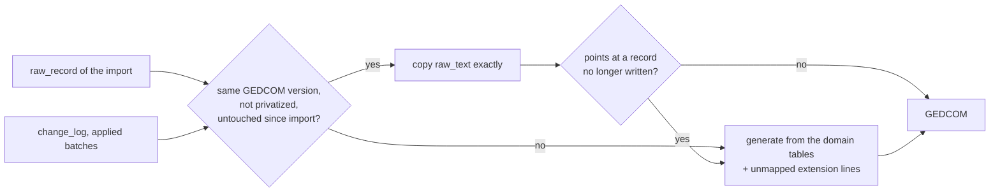

# @open-ancestry/export

Exports a tree as GEDCOM 5.5.1 (what Ancestry reads), GEDCOM 7, or GEDZIP (GEDCOM 7 plus media files). The JSON backup lives in `@open-ancestry/db` (`exportJson`).

```ts
import { exportGedcom, exportGedzip, buildGedcomExport } from '@open-ancestry/export';

const ged = exportGedcom(store); // GEDCOM 5.5.1, Ancestry-compatible (CHAR UTF-8)
const ged7 = exportGedcom(store, { version: '7', privatizeLiving: true });
const zip = exportGedzip(store); // Uint8Array: gedcom.ged + media/
const { text, xrefs, stats } = buildGedcomExport(store, { version: '7' });
```

| Option           | Default | Meaning                                                                                                                                                 |
| ---------------- | ------- | ------------------------------------------------------------------------------------------------------------------------------------------------------- |
| `version`        | `5.5.1` | `5.5.1` or `7`.                                                                                                                                         |
| `privatizeLiving` | false  | Living people (`living`, `inferred_living` or `unknown`) become `NAME Private` with their sex and family links only. See [privacy](#privatize-living). |
| `includeMedia`   | true    | Write `OBJE` records, links and `_PHOTO`.                                                                                                               |
| `now`            | now     | `HEAD.DATE` of a generated header.                                                                                                                      |

Both `build*` functions return `warnings`: imported lines a regenerated record could not carry over, and (GEDZIP) media files that could not be added. The server sends them to the Export dialog, which lists them. Both throw `GedcomSerializeError` if a row cannot be written as valid GEDCOM; the server answers that with a 409 naming the problem.

## How records are written



- **Verbatim.** A record is copied from `raw_record` when the export is in the GEDCOM version it was imported from, nothing is privatized, and no applied change batch touched it or anything written inside it (names, events and their places, child links, citations, inline notes and media). Undone batches restored their rows, so they do not count. Changes to `living`, `surname_key` or timestamps alone do not count either: no GEDCOM line comes from them. This keeps every Ancestry tag, including those the importer never mapped.
- **Generated.** Everything else (edited records, records created in the app, exports to the other version, privatized exports, GEDZIP) is written from the domain tables, with Ancestry's tags (`_APID`, `_PHOTO` and `_PRIM`, `_MTTAG`, `_FREL`/`_MREL`, `ADOP.FAMC`, `_OID`, custom facts) as Ancestry writes them. A 5.5.1 association's `ASSO.RELA` text becomes a GEDCOM 7 `ROLE` (the matching value such as `GODP`, else `OTHER`) with the text as `PHRASE`, and back again. An event type that is neither a standard GEDCOM event nor an `_` extension tag (`Graduation` from the edit API) is written as `EVEN` with `TYPE Graduation`.
- **Unmapped lines go back where they were.** The importer keeps every line it did not map in `unmapped_line`; the imported raw text says which structure each sat under. A regenerated record gets each one back under the matching structure (found by tag and content: pointer, value, DATE, PLAC, PAGE; or by position), so `2 _SRC parish copy` stays under its BIRT. A line that cannot be placed is listed in `warnings`, never dropped silently: its structure was deleted, it points at a record not in the export, it would contradict an edited value, or its tag is not GEDCOM 7 in a GEDCOM 7 export. Privatized people and families leave their unmapped lines out on purpose.
- **Xrefs.** Imported xrefs are kept, so copied records still resolve. New records get the next free `@I<n>@`, `@F<n>@`, `@S<n>@`, `@R<n>@`, `@O<n>@`, `@N<n>@`, `@T<n>@`, assigned in a fixed order (people and families by row id, then records as they are first referenced), so repeated exports of the same tree give the same xrefs. A copied record that points at a record no longer written (deleted, or regenerated under another xref) is regenerated; pointers that were already broken in the imported file are left alone.
- **Order.** Records come out in the order of the imported file, then new records by type.
- **HEAD.** A verbatim export keeps the imported `HEAD`, changing only `CHAR` to `UTF-8` and `GEDC` to `5.5.1`/`LINEAGE-LINKED` (5.5.1), or adding `SCHMA` entries (7). Otherwise the header is generated (`SOUR open-ancestry`, the tree name in `SOUR.DATA`, `_HOME` for the home person unless they are privatized, and a `SUBM` in 5.5.1).
- **Shared rows** are written as records: notes linked from more than one place or imported as `NOTE` records, every media item, every source. Records nothing points at (a source with no citations, a tag on no one) are still exported.

### GEDCOM 7 specifics

No `CONC` (long values stay on one line, line breaks become `CONT`), `@@` only for a leading `@`, `SNOTE` for shared notes, `FILE` paths percent-encoded with a `FORM` MIME type, and `HEAD.SCHMA` for every extension tag (URIs in [docs/gedcom-extensions.md](../../docs/gedcom-extensions.md)). Dates, ages and name types outside the GEDCOM 7 grammar keep the original text in a `PHRASE`:

```
2 DATE ABT 1842        2 AGE 25y        2 TYPE OTHER
3 PHRASE Abt. 1842     3 PHRASE 25      3 PHRASE Religious
```

The importer reads the `PHRASE` back as the date, age or name type as written, so a GEDCOM 7 round trip keeps `Abt. 1842`.

## Round trips

Tests (`src/roundtrip.test.ts`) run every fixture through:

1. **Same version.** Import, export in the file's own version, compare with the original. The comparison normalizes only what an export legitimately changes: the file as decoded (no BOM, LF line endings), without unparseable lines before `HEAD`, without `HEAD.CHAR`, `HEAD.GEDC` and `HEAD.SCHMA`, and with a final `TRLR`. The diff must be empty.
2. **GEDCOM 7.** Import, export GEDCOM 7, check it is valid (re-parsed with zero warnings, no `CONC`, every extension tag declared, every pointer resolving, dates and ages in GEDCOM 7 grammar), re-import, and compare the domain model: people, names, events, places, families, child relationship types, citations with every `_APID`, notes, tags, media.
3. **Generated GEDCOM 5.5.1.** With `raw_record` removed so every record is generated, the same domain comparison.

`src/edits.test.ts` checks that an edit regenerates only the records it touched and leaves every other record byte for byte as imported.

## Privatize living

Privatize is an allowlist, not a filter. Every record is generated (never copied, since raw text can mention anyone) and gets a fresh xref (`@I1@`, `@F1@`, ...), because imported ids can spell names (`@ZELDAQUIXBY@`). Then:

- **Withheld people:** anyone who may be living (`isLiving()`: living, inferred living or unknown), and anyone marked `private` or `confidential` (GEDCOM `RESN privacy` / `confidential`). They are written as `NAME Private`, `SEX`, `FAMC` and `FAMS`, with nothing under them. `RESN locked` means "do not change this record", not private, so locked records are exported as usual. RESN fails closed: any RESN word other than `locked` or `public` (`privacy.`, `restricted`, a continuation line) counts as private, and a RESN the importer did not map (under a name, citation or media link, or on a source, note or media record) withholds what it sits on.
- **Withheld families:** a family with a withheld partner, or marked private or confidential, keeps only `HUSB`, `WIFE` and `CHIL`.
- **Withheld events:** an event marked private or confidential is left out, even under someone who is otherwise exported.
- **Notes and media:** anything attached to a withheld person, family or event (directly, or through their names, child links or citations) is left out of the whole export, even where someone else shares it. A media file shared with a withheld item is withheld too; the importer stores identical files once, and the name is often the person's.
- **Imported lines:** no unmapped or extension line is merged into a withheld record. A line elsewhere that points at a withheld record (an `ASSO` and its `RELA`) is dropped, and warnings name only the record and the tag path, never the text. Imported custom (`_`) lines are left out of every record, since nobody vetted what they say; each record's warning says how many.
- **Names in other records' text (best effort):** names of withheld people are replaced with `Private` in the text of every record that is written: notes, event values and `TYPE`, titles, source text, custom values, media file names (and GEDZIP entry names), links and e-mail addresses, and imported record ids in text. A name is recognized as any word of three or more letters from any name the person goes by (given names, surnames, nicknames, the name as written); a given name and surname together when either is shorter (`Li Wu`, either order); inside longer text for scripts written without spaces (`李明` in `李明的照片`); regardless of accents and case (`Zoe Muller` for Zoë Müller); in words glued to digits or run together (`zedekiah2015`, `ZedekiahLivingson`); and, in file names and links, inside longer words after percent-decoding (`facebook.com/zedekiahlivingson`). Matching errs towards removing too much: a deceased relative's notes lose a shared surname, and a common word that is also a name goes too; their own `NAME` keeps it. Places (`PLAC`) are kept as written, so a place named after a living person (`Livingson Farm`) stays. Free text can still identify someone in other words (a nickname nobody recorded, "my grandson the doctor"), which the export dialog says: read notes before sharing.
- **Shared records:** sources, repositories and tags are written only if something still written points at them, or nothing in the tree uses them at all.
- **Header:** the submitter (usually the user) is replaced by a generic one. `HEAD` has no tree name (often a surname) and no `_HOME` pointing at a withheld home person. The server names a privatized download `private-tree.ged` / `.gdz`.

The export dialog turns privatize on whenever the tree has anyone it would hide, fails closed (privatize stays on, and Export waits, until the tree has been checked; if the check fails it stays on with a warning), and warns how many people a full export includes when it is turned off. The API takes `privatize=true` explicitly.

Tests put a unique canary in every kind of line a withheld person and their family can have, including private and confidential records (and a locked one that must still be exported), name-like xrefs, an association's `RELA`, a shared photo file and the tree name. They assert that none reaches 5.5.1, 7 or GEDZIP output, the warnings or the archive's file names. Every fixture is also searched for every word that appears only in living people's data.

## GEDZIP

`gedcom.ged` (GEDCOM 7) plus each referenced media file at its `local_path` under the tree's `media/` folder (`FILE photos/odile%20portrait.png`). Files are read only if their real path (after symlinks) is inside that folder; a missing or refused file is reported in `warnings` and left out, and its `FILE` keeps the relative path. A media path that would collide with `gedcom.ged` (in any case) moves under `media/`. Already-compressed formats are stored, the rest deflated.

## Performance

`npm run bench -- export` on a 10k-person tree (M-series laptop): 5.5.1 verbatim about 120 ms, GEDCOM 7 about 380 ms, privatized about 270 ms, GEDZIP about 440 ms. Budget 1 s each.
