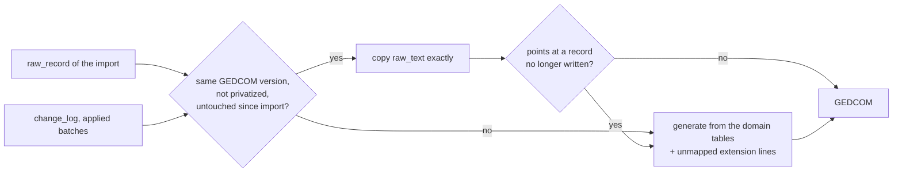

# @open-ancestry/export

Exports a tree as GEDCOM 5.5.1 (what Ancestry reads), GEDCOM 7, or GEDZIP (GEDCOM 7 plus media files). The JSON backup lives in `@open-ancestry/db` (`exportJson`).

```ts
import { exportGedcom, exportGedzip, buildGedcomExport } from '@open-ancestry/export';

const ged = exportGedcom(store); // GEDCOM 5.5.1, Ancestry-compatible (CHAR UTF-8)
const ged7 = exportGedcom(store, { version: '7', privatizeLiving: true });
const zip = exportGedzip(store); // Uint8Array: gedcom.ged + media/
const { text, xrefs, stats } = buildGedcomExport(store, { version: '7' });
```

| Option           | Default | Meaning                                                                                                                                                 |
| ---------------- | ------- | ------------------------------------------------------------------------------------------------------------------------------------------------------- |
| `version`        | `5.5.1` | `5.5.1` or `7`.                                                                                                                                         |
| `privatizeLiving` | false  | Living people (`living`, `inferred_living` or `unknown`) become `NAME Private` with their sex and family links only. See [privacy](#privatize-living). |
| `includeMedia`   | true    | Write `OBJE` records, links and `_PHOTO`.                                                                                                               |
| `now`            | now     | `HEAD.DATE` of a generated header.                                                                                                                      |

`buildGedzipExport` also returns `warnings` for media files it could not add. Both throw `GedcomSerializeError` if a row cannot be written as valid GEDCOM; the server answers that with a 409 naming the problem.

## How records are written



- **Verbatim.** A record is copied from `raw_record` when the export is in the GEDCOM version it was imported from, nothing is privatized, and no applied change batch touched it or anything written inside it (names, events and their places, child links, citations, inline notes and media). Undone batches restored their rows, so they do not count. Changes to `living`, `surname_key` or timestamps alone do not count either: no GEDCOM line comes from them. This keeps every Ancestry tag, including those the importer never mapped.
- **Generated.** Everything else (edited records, records created in the app, exports to the other version, privatized exports, GEDZIP) is written from the domain tables, with Ancestry's tags (`_APID`, `_PHOTO`, `_MTTAG`, `_FREL`/`_MREL`, `_OID`, custom facts) as Ancestry writes them. Top-level extension lines the importer kept in `unmapped_line` (`1 _SKYPEID ...`) are merged back; lines nested inside mapped structures, and any with a pointer, are not, because they cannot be placed safely.
- **Xrefs.** Imported xrefs are kept, so copied records still resolve. New records get the next free `@I<n>@`, `@F<n>@`, `@S<n>@`, `@R<n>@`, `@O<n>@`, `@N<n>@`, `@T<n>@`, assigned in a fixed order (people and families by row id, then records as they are first referenced), so repeated exports of the same tree give the same xrefs. A copied record that points at a record no longer written (deleted, or regenerated under another xref) is regenerated; pointers that were already broken in the imported file are left alone.
- **Order.** Records come out in the order of the imported file, then new records by type.
- **HEAD.** A verbatim export keeps the imported `HEAD`, changing only `CHAR` to `UTF-8` and `GEDC` to `5.5.1`/`LINEAGE-LINKED` (5.5.1), or adding `SCHMA` entries (7). Otherwise the header is generated (`SOUR open-ancestry`, the tree name in `SOUR.DATA`, `_HOME` for the home person, and a `SUBM` in 5.5.1).
- **Shared rows** are written as records: notes linked from more than one place or imported as `NOTE` records, every media item, every source. Records nothing points at (a source with no citations, a tag on no one) are still exported.

### GEDCOM 7 specifics

No `CONC` (long values stay on one line, line breaks become `CONT`), `@@` only for a leading `@`, `SNOTE` for shared notes, `FILE` paths percent-encoded with a `FORM` MIME type, and `HEAD.SCHMA` for every extension tag (URIs in [docs/gedcom-extensions.md](../../docs/gedcom-extensions.md)). Dates, ages and name types outside the GEDCOM 7 grammar keep the original text in a `PHRASE`:

```
2 DATE ABT 1842        2 AGE 25y        2 TYPE OTHER
3 PHRASE Abt. 1842     3 PHRASE 25      3 PHRASE Religious
```

The importer reads the `PHRASE` back as the date, age or name type as written, so a GEDCOM 7 round trip keeps `Abt. 1842`.

## Round trips

Tests (`src/roundtrip.test.ts`) run every fixture through:

1. **Same version.** Import, export in the file's own version, compare with the original. The comparison normalizes only what an export legitimately changes: the file as decoded (no BOM, LF line endings), without unparseable lines before `HEAD`, without `HEAD.CHAR`, `HEAD.GEDC` and `HEAD.SCHMA`, and with a final `TRLR`. The diff must be empty.
2. **GEDCOM 7.** Import, export GEDCOM 7, check it is valid (re-parsed with zero warnings, no `CONC`, every extension tag declared, every pointer resolving, dates and ages in GEDCOM 7 grammar), re-import, and compare the domain model: people, names, events, places, families, child relationship types, citations with every `_APID`, notes, tags, media.
3. **Generated GEDCOM 5.5.1.** With `raw_record` removed so every record is generated, the same domain comparison.

`src/edits.test.ts` checks that an edit regenerates only the records it touched and leaves every other record byte for byte as imported.

## Privatize living

Every record is generated (never copied, since raw text can mention anyone). A living person is `NAME Private`, `SEX`, `FAMC` and `FAMS`, nothing else: no events, notes, citations, media, tags, child relationship types or unmapped lines. A family with a living partner keeps only `HUSB`, `WIFE` and `CHIL`. Shared records (sources, notes, media, tags, repositories) are written only if something still written points at them, or nothing in the tree uses them at all, so a source cited only for a living person disappears with the citation. The submitter record (usually the user) is replaced by a generic one. Tests search the whole output for every word that appears only in living people's data.

## GEDZIP

`gedcom.ged` (GEDCOM 7) plus each referenced media file at its `local_path` under the tree's `media/` folder (`FILE photos/odile%20portrait.png`). Files are read only if their real path (after symlinks) is inside that folder; a missing or refused file is reported in `warnings` and left out, and its `FILE` keeps the relative path. A media path that would collide with `gedcom.ged` (in any case) moves under `media/`. Already-compressed formats are stored, the rest deflated.

## Performance

`npm run bench -- export` on a 10k-person tree (M-series laptop): 5.5.1 verbatim about 120 ms, GEDCOM 7 about 380 ms, privatized about 270 ms, GEDZIP about 440 ms. Budget 1 s each.
